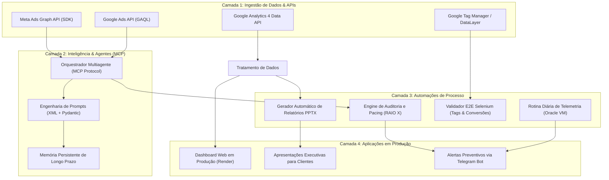

# Portfólio de Engenharia de IA, Agentes Autônomos & Automações em Produção

[](https://www.python.org/)
[](LICENSE)
[](03-deployed-tools-and-agents/agentic-framework-mcp/)
[](https://road-dashboard-performance-2.onrender.com/)

**Autor:** Juan Santos Oliveira (JJSO)  
**Atuação:** Analista de Mídia de Performance, Engenharia de Prompt e Automação de IA  
**LinkedIn:** [linkedin.com/in/juan-s-oliveira](https://www.linkedin.com/in/juan-s-oliveira)  
**GitHub:** [github.com/yuichisadog](https://github.com/yuichisadog)  
**Localização:** Porto Alegre, RS, Brasil (Disponibilidade Remoto)

---

## 1. Visão Geral do Repositório

Este repositório reúne ferramentas internas deployadas, suítes de experimentação com LLMs, agentes autônomos baseados em MCP (Model Context Protocol) e automações de engenharia de software desenvolvidas para resolver gargalos operacionais e financeiros reais em marketing de performance e inteligência de dados.

Todas as soluções aqui documentadas estão ou estiveram em ambiente de produção, operando sob verbas superiores a **R$ 100.000,00/mês**, atendendo lideranças de negócio, equipes multidisciplinares e clientes corporativos de múltiplos setores econômicos.

---

## 2. Matriz de Correspondência com Requisitos Técnicos

A tabela abaixo conecta diretamente cada competência avaliada ao respectivo módulo implementado com código-fonte e documentação técnica neste repositório:

| Requisito / Critério Avaliado | Módulo do Repositório | Evidência Técnica & Arquitetura |
| :--- | :--- | :--- |
| **1. Prompts estruturados e experimentações com LLMs** | [`01-prompt-engineering/`](01-prompt-engineering/) | Tags XML de isolamento, CoT, validação estrita via Pydantic, protocolo Source-Only (zero alucinação) e benchmarks paramétricos de temperatura. |
| **2. Automações que economizaram horas reais** | [`02-process-automations/`](02-process-automations/) | Pipeline `python-pptx` de geração de apresentações executivas (economia de 15-20h/semana), motor de RAIO X e alertas de runway financeiro. |
| **3. Ferramentas internas deployadas, dashboards ou agentes** | [`03-deployed-tools-and-agents/`](03-deployed-tools-and-agents/) | Dashboard multi-contas deployado no Render (`https://road-dashboard-performance-2.onrender.com/`), framework multiagente MCP e validador Selenium E2E. |
| **4. Soluções em produção com resultados mensuráveis** | [`04-production-case-studies/`](04-production-case-studies/) | 4 cases auditados (Indústria B2B, Shopping Center, E-commerce e Serviços de Alto Padrão) com Blended ROAS de até 4.88x e -28% de CPA. |
| **5. Visão Sistêmica Integrada (Todas as opções acima)** | **Visão Geral & Diagrama** | Integração completa de ingestão de dados, orquestração de IA, pipelines determinísticos e entrega executiva. |

---

## 3. Arquitetura do Sistema Integrado



---

## 4. Detalhamento dos Módulos

### [Módulo 01: Prompt Engineering & Experimentação com LLMs](01-prompt-engineering/)
- **Protocolo Source-Only:** Prevenção mecânica de alucinações através da exigência de citação de IDs e valores presentes estritamente no bloco de dados.
- **Prompts de Decisão Determinística:** Instruções XML com cadeia de raciocínio (Chain-of-Thought) para corte, escala e reestruturação de campanhas de leilão.
- **Experimentos Paramétricos:** Scripts com medição estatística de desvio padrão e taxa de sucesso de parse JSON variando temperatura entre 0.0 e 1.0.

### [Módulo 02: Automações de Processo com Economia Real de Horas](02-process-automations/)
- **Geração de Relatórios Executivos:** Automação em Python com `python-pptx` que constrói decks completos a partir de dados brutos. Redução do tempo de entrega de 3 horas por cliente para menos de 4 minutos (mais de 15h semanais economizadas por gestor).
- **RAIO X e Governança de Fundos:** Algoritmo que calcula o ritmo diário de consumo (pacing index) e projeta os dias restantes de saldo (runway), alertando solicitações de boleto e PI com 5 a 7 dias de antecedência.
- **Renderização Criativa em Lote:** Injeção programática de copy em templates HTML/CSS para geração rápida de criativos modulares.
- **Telemetria em Nuvem:** Rotina agendada via cron em Máquina Virtual Oracle Cloud enviando relatórios diários de integridade via Telegram Bot.

### [Módulo 03: Ferramentas Internas Deployadas, Dashboards e Agentes](03-deployed-tools-and-agents/)
- **Dashboard Road Performance:** Aplicação ativa em produção no Render ([link público](https://road-dashboard-performance-2.onrender.com/)) consolidando o desempenho de toda a carteira de clientes para a diretoria e analistas.
- **Agentes Especializados com MCP:** Ferramentas customizadas para leitura de métricas, inteligência competitiva de criativos e persistência de regras de negócio em disco.
- **Validador E2E com Selenium:** Simulação headless de jornadas de usuário para auditar o disparo de eventos no `dataLayer` e certificar que conversões essenciais estão sendo contabilizadas antes de qualquer ativação de campanha.

### [Módulo 04: Casos de Uso em Produção & Resultados Mensuráveis](04-production-case-studies/)
- **Indústria Química B2B (Multinacional):** CPM otimizado de R$ 1,10 a R$ 1,30 no Brasil e R$ 0,80 LATAM com blindagem total de marca institucional.
- **Shopping Center Regional:** Qualificação algorítmica de leads para captação de lojistas com aporte superior a R$ 100.000,00, fechando contratos com marcas consagradas (Subway, Kopenhagen, Divino Fogão).
- **E-Commerce Varejo Direto:** Reestruturação de campanhas Performance Max com Blended ROAS de 4.88x (R$ 121k em receita) e PMax Best Sellers atingindo 6.05x de ROAS.
- **Serviços Especiais de Alto Padrão:** Modelo de conversões ponderadas por Expected Value com ROAS real em fechamento entre 85x e 92x e CAC de mídia de R$ 32,65.

---

## 5. Como Executar e Validar Localmente

### Pré-requisitos
- Python 3.10 ou superior
- Git

### Instalação
```bash
# Clonar o repositório
git clone https://github.com/yuichisadog/ai-solutions-portfolio.git
cd ai-solutions-portfolio

# Criar ambiente virtual
python -m venv venv
source venv/bin/activate  # No Windows: .\venv\Scripts\Activate.ps1

# Instalar dependências
pip install -r requirements.txt
```

### Executar Testes e Demonstrações
```bash
# 1. Executar o experimento de temperatura e validação de prompts
python 01-prompt-engineering/experiments/temperature_eval.py

# 2. Rodar a suíte de testes de schema Pydantic
pytest 01-prompt-engineering/experiments/test_prompt_eval.py

# 3. Gerar um relatório executivo de teste em PPTX
python 02-process-automations/automated-reporting/generate_deck.py

# 4. Rodar o motor de auditoria de pacing e runway financeiro
python 02-process-automations/health-check-engine/auditoria_contas.py
```

---

## 6. Contato e Conexões

- **Nome:** Juan Santos Oliveira
- **Email:** juan.jso2000@gmail.com
- **WhatsApp:** +55 (51) 99956-7153
- **LinkedIn:** [linkedin.com/in/juan-s-oliveira](https://www.linkedin.com/in/juan-s-oliveira)
- **Portfólio Notion:** [Notion Portfolio](https://notion.so/yuichisadog/Portfolio-218af2ffe014806a9a90d97f9121f80a)
